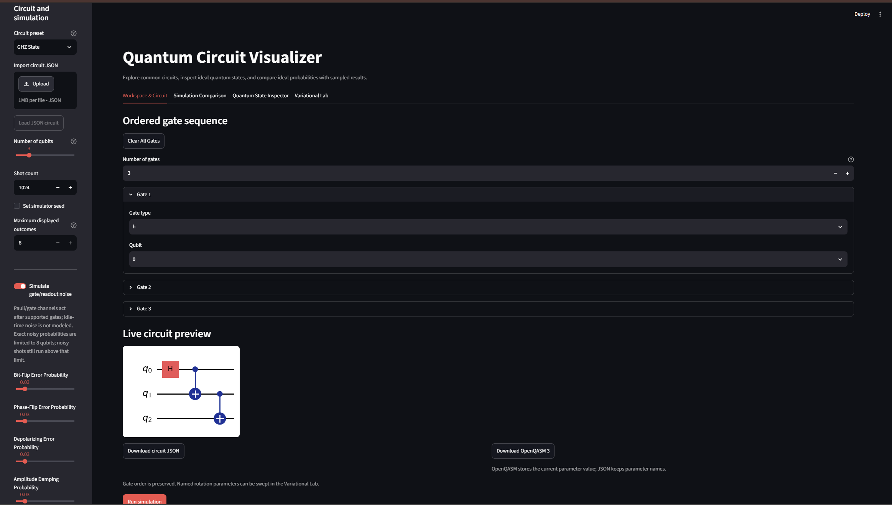
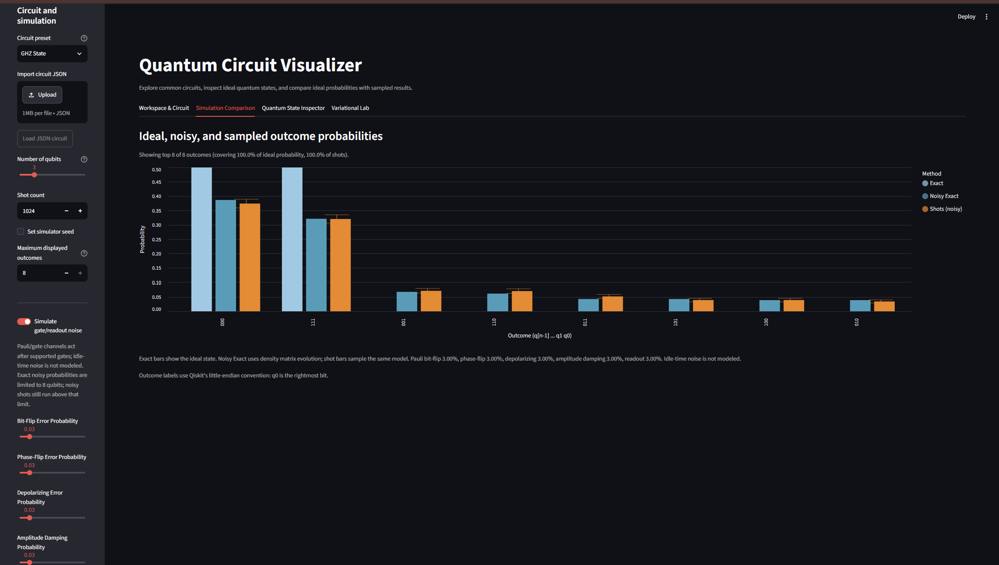
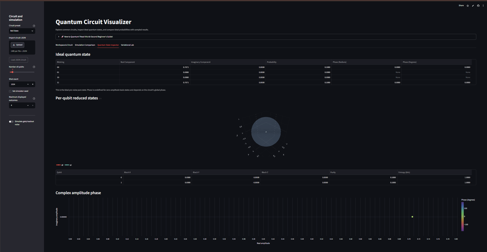

**Live demo:** https://quantum-circuit-viz.streamlit.app

# Quantum Circuit Visualizer

A Streamlit learning app for building editable Qiskit circuits, exploring their statevectors, and comparing ideal predictions with finite-shot or noisy simulation.

The workspace provides live Matplotlib circuit diagrams; the inspector includes a Plotly Bloch-sphere view and reduced-state metrics.

## Features

- **Workspace & Circuit:** Build and edit circuits, set rotation parameters via dual-control inputs (high-precision sliders or direct keyboard typing), preview gates, and run simulations.
- **Onboarding Quickstart:** An interactive, built-in 60-Second Guided Tour featuring an explicit Gate Cheat Sheet to orient non-technical users and first-time visitors.
- **Simulation Comparison:** Compare ideal, noisy, and finite-shot outcome probabilities side by side.
- **Quantum State Inspector:** Explore statevectors, per-qubit reduced states, and state metrics.
- **Variational Lab:** Sweep named circuit parameters over continuous wave line graphs and run a toy VQE demonstration.

Presets include `Bell State`, `GHZ State`, `Quantum Coin Toss`, `3-Qubit Uniform Superposition`, `QFT (3 qubits)`, `Grover (marked 111)`, `Deutsch–Jozsa (balanced)`, `Deutsch–Jozsa (constant)`, and `Bernstein–Vazirani (secret 01)`.

## Screenshots



_GHZ State circuit in the Workspace & Circuit tab._



_GHZ State, 3 qubits, 1024 shots, all noise channels at 3%: exact, noisy exact and noisy shot probabilities._



_Quantum State Inspector tab showcasing statevector probabilities, scalar purity, von Neumann entropy, and complex amplitude phases._

## Run locally

```powershell
python -m venv .venv
.\.venv\Scripts\python.exe -m pip install -r requirements.txt
.\.venv\Scripts\python.exe -m streamlit run app.py
```

macOS/Linux:

```bash
python3 -m venv .venv
source .venv/bin/activate
pip install -r requirements.txt
streamlit run app.py
```

Streamlit prints local and network URLs in the terminal after startup. Use the local URL on the same computer; the network URL is for devices that can reach the computer over the same network.

The macOS/Linux commands have not been tested by the author; CI runs the tests on Ubuntu with Python 3.12.

## Test

```powershell
.\.venv\Scripts\python.exe -m pip install -r requirements-dev.txt
.\.venv\Scripts\python.exe -m unittest discover -s tests -v
```

Development tools, including Ruff, come from `pip install -r requirements-dev.txt`.

## Stress tests

The optional stress suite exercises maximum-size simulations, randomized
validation and UI actions, statistical sampling, repeated resource use, and
the largest supported Streamlit configuration. It is skipped during normal
test discovery. Run it explicitly with:

```powershell
$env:RUN_STRESS="1"; .\.venv\Scripts\python.exe -m unittest discover -s tests -p "test_stress.py" -v
```

## Structure

- `app.py`: Streamlit controls, session state, charts, user onboarding walkthrough, circuit preview, and state inspection.
- `quantum_engine.py`: Qiskit circuit validation/construction, exact and noisy simulations, shot experiments, exports, and quantum-state metrics.
- `tests/`: Engine and Streamlit regression tests.
- `requirements.txt`: Top-level runtime dependencies.
- `requirements-lock.txt`: Resolved package versions for reproducible local installs.
- `pyproject.toml`: Project metadata and Ruff lint/format configuration.
- `plan.md`: Architecture and implementation contracts.

The engine uses Qiskit's little-endian bitstring convention (`q[n-1] ... q1 q0`, q0 at the right), limits exact simulation to 10 qubits, and caps circuits at 50 gates and experiments at 100,000 shots. Exact noisy probability simulation is limited to 8 qubits; noisy shot sampling remains available above that limit. The optional noise model affects supported gate operations and/or measurement; it does not model idle-time noise.

Supported gates are `h`, `x`, `y`, `z`, `s`, `t`, `swap`, `cx`, `cz`, `ccx`, `rx`, `ry`, `rz`, `p`, and `cp`.

Importing a circuit restores its gates and parameter names, but not parameter values, shots, seed, noise settings, or maximum displayed outcomes. OpenQASM downloads store the current parameter value, while JSON exports keep parameter names.

## Code quality and CI

Install development tools with `pip install -r requirements-dev.txt`. Run Ruff locally with `ruff check .` and `ruff format .`. GitHub Actions runs Ruff and the unittest suite on pushes and pull requests using Python 3.12.

**Python version:** Python 3.12 is recommended to align with the CI environment. Python 3.12.16 provides stable execution, whereas isolated Windows configurations have exhibited native extension access violations (`_accelerate.pyd`) when pairing Python 3.13.9 with Qiskit 2.6.1.

## License

MIT. See the LICENSE file.
